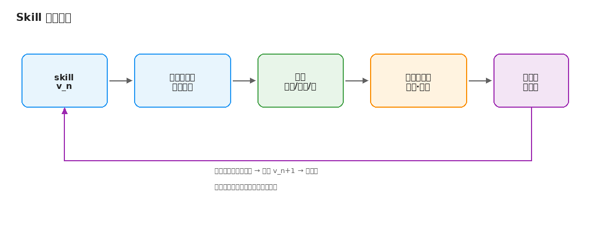
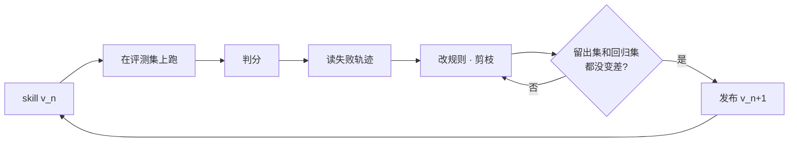

# Skill 迭代手册：把 v1 改到 v2、v3

写一个给 AI 助手用的 skill（或系统提示词、agent 指令）不难，难的是第二版。v1 上线以后，你会发现它有时管用，有时不管用，改一处又坏一处，越改越长，最后谁也说不清哪一句在起作用。

这本小书讲第二版之后的事：怎么建小评测集，怎么判分，怎么从失败轨迹里找出该改的地方，什么时候交给自动优化器，怎么删，以及一次跑很贵时怎么省。材料来自 Anthropic、OpenAI、AWS 等官方文档，GEPA、EvoSkill、BudgetAPO、ACE 等论文，以及 Hamel Husain 等一线经验；也收录少数可借用的间接思路（TDD、坏味道、A/B、精益），并标明如何改写、何处是推测。

全书由浅入深：背景 → 全景 → 测量 → 改进 → 加速与发版 → 案例 → 要点。每一章按工程师要做的决定来组织。

## 迭代循环总览

## 目录

**背景与地图**

1. [背景与全景图](chapters/01-background-and-map.md) — 为什么第二版最难；五个环节、三条原则、材料层次。

**怎么做**

2. [先测清楚：目标、评测集、判分](chapters/02-measure.md) — 优化什么、题从哪来、盲测、三种判官。
3. [改进：从失败轨迹到更短的下一版](chapters/03-improve.md) — 错误分析、规则三层次、剪枝与 skill smells。
4. [加速与省钱：自动优化、高成本运行、发版](chapters/04-accelerate.md) — GEPA / EvoSkill / BudgetAPO / AgentCore；分层跑；回归检查单。

**案例与收束**

5. [案例：Harbor 接入 skill 的 v1 到 v3](chapters/05-case-harbor.md) — 6 个手写基准做盲测，从 v1 走到 v3。
6. [要点，以及可以从别处借什么](chapters/06-takeaways-and-borrow.md) — 十条要点、最短路径、间接来源的改写。

另外：

- [推荐阅读](reading.md) — 约 10 份值得通读的材料与覆盖表。
- [参考来源](sources.md) — 约 45–50 条分层来源。
- [figures/](figures/) — 书中插图（PNG）；可用 diagrams.net 打开同名思路自行改绘。

## 一句话版本

先有评测，再改 skill；改之前读轨迹，改完之后删；每次只看留出集上的分数，答案永远不进 skill。
