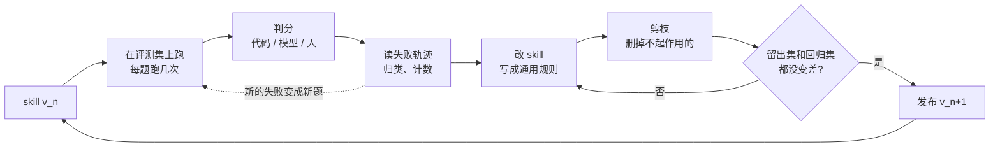

# Skill 迭代手册：把 v1 改到 v2、v3

写一个给 AI 助手用的 skill（或系统提示词、agent 指令）不难，难的是第二版。v1 上线以后，你会发现它有时管用，有时不管用，改一处又坏一处，越改越长，最后谁也说不清哪一句在起作用。

这本小书讲的就是第二版之后的事：怎么建一个小评测集，怎么判分，怎么从失败的轨迹里找出该改的地方，什么时候交给自动优化器，怎么删，以及一次跑很贵的时候怎么省。材料来自 Anthropic、OpenAI 等公司的官方文档和工程博客，DSPy、GEPA、ACE 等论文，以及 Hamel Husain 等一线从业者的经验。

每一章都按工程师要做的决定来组织：要决定什么，有哪些选项，各自的代价，什么情况选哪个。

## 迭代循环总览

第 3 到第 10 章就是把这张图上每一个方块拆开讲。最容易被跳过的是「读失败轨迹」和「剪枝」，而这两步恰恰最值钱。

## 目录

全书由浅入深分四部分：先讲背景，再给全景图，然后逐块展开具体做法，最后用一个案例串起来并总结。

**第一部分　背景**

1. [为什么 skill 需要迭代](chapters/01-background.md)：skill 是一种用自然语言写的软件，第二版为什么最难。

**第二部分　全景图**

2. [一轮迭代由哪些部分组成](chapters/02-map.md)：五个环节、三条原则、人和模型的分工。

**第三部分　具体做法**

3. [迭代到底在优化什么](chapters/03-what-to-optimize.md)：定清楚「变好」的意思，以及 skill 和 harness 的边界。
4. [搭一个小评测集](chapters/04-eval-set.md)：题从哪来、要多少、怎么分留出集、怎么做盲测。
5. [怎么判分](chapters/05-grading.md)：代码判、模型判、人判各管什么，怎么让判官可信。
6. [从失败轨迹到下一版](chapters/06-failure-to-rule.md)：错误分析，以及怎么把发现写成通用规则而不泄露答案。
7. [要不要交给自动优化器](chapters/07-auto-optimizers.md)：DSPy、GEPA、OPRO、ACE、自我进化 agent 各适合什么情况。
8. [剪枝：防止越改越长](chapters/08-pruning.md)：找出哪几句真正起作用，怎么删。
9. [一次跑很贵时怎么迭代](chapters/09-expensive-runs.md)：容器、长任务、429 限流下的省钱办法。
10. [回归检查和发版](chapters/10-regression-release.md)：确认新版没把旧的弄坏，模型升级后怎么办。

**第四部分　案例与要点**

11. [案例：Harbor 接入 skill 的 v1 到 v3](chapters/11-case-harbor.md)：把前面的做法套到一个真实的端到端任务上。
12. [意义与要点](chapters/12-takeaways.md)：十条要点和最短的上手路径。

另外两页：

- [推荐阅读](reading.md)：值得完整读一遍的 8 份材料，以及它们覆盖了哪些章节。
- [参考来源](sources.md)：书中引用的全部来源。

## 一句话版本

先有评测，再改 skill；改之前读轨迹，改完之后删；每次只看留出集上的分数，答案永远不进 skill。
