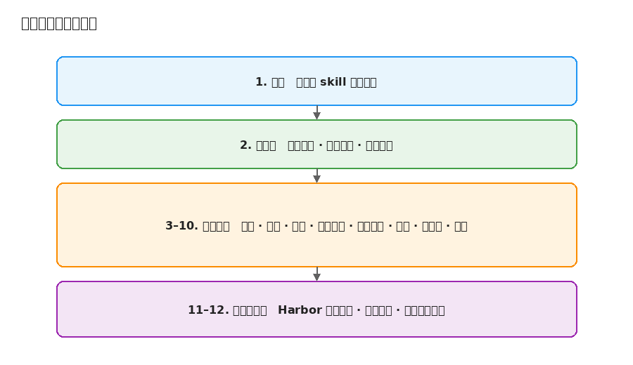
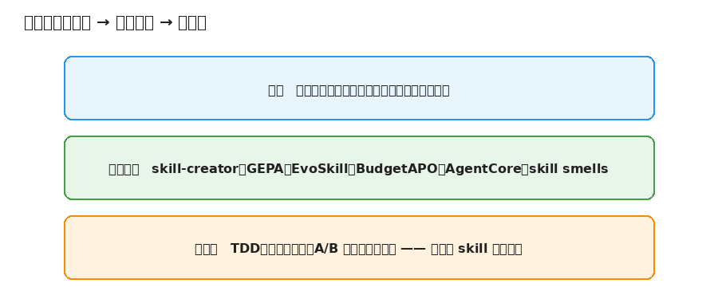
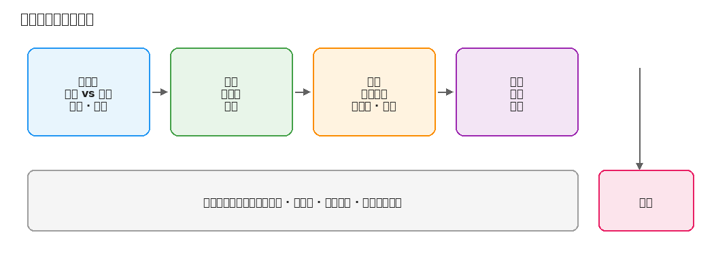
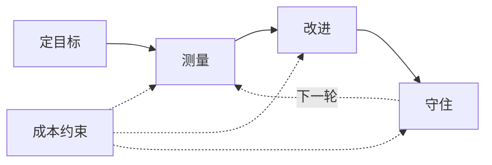

# 1. 背景与全景图

## 为什么 skill 需要迭代

过去一年，给 AI 助手写的说明文件越来越多：Anthropic 的 Agent Skills、Cursor 的 rules、各家 agent 的系统提示词、仓库里的 AGENTS.md。它们的共同点是用自然语言写，给模型读，决定 agent 怎么做事。

Anthropic 把 Agent Skills 描述成一个文件夹：里面有说明、脚本和参考材料。启动时 agent 只看到每个 skill 的名字和描述，需要时才读正文，正文引用的文件再按需打开（渐进式披露）。这让 skill 可以很长，又不必一次全塞进上下文。

但写出来只是开始。和代码一样，skill 也有 bug，也会在换模型、换工具后失效，也需要测试和维护。不同的是，代码的 bug 能被编译器和测试精确定位，skill 的 bug 往往只表现为「这次 agent 没做好」。

v1 通常是作者把自己的经验写下来。之后会遇到：

- **不知道改动有没有用**。没有评测，只能靠几次试用的印象。
- **修一处坏一处**。Anthropic 的评测文章把这叫作被动循环：只在生产里发现问题，修好一个又引出别的。
- **越改越长**。每次失败加一句，很快没人说得清哪一句在起作用。
- **对手上的例子过拟合**。在测试用的几道题上很好，换一道就不行。
- **跑一次太贵**。端到端任务要容器、要时间、要 API 额度，没法像改函数那样随改随测。

一份对 238 个真实 SKILL.md 的实证研究（「skill smells」论文）发现：超过 99% 的文件至少有一种坏味道，平均每个文件大约 10.5 个；这些坏味道一旦写进去，很少在后续提交里消失。推荐的写法与实际写法之间有明显差距。另一篇对约 13.8 万个 SKILL.md 的研究也显示，描述过短、正文过长、把该放进参考文件的细节堆在正文里，都很常见。迭代不只是加内容，也是持续清掉这些坏味道。

## 材料从哪来

大致三层：

1. **基础**：评测是什么、判官怎么校准、错误分析怎么做（Anthropic 评测文章、Hamel 的评测问答与「先看数据」系列）。
2. **直接相关**：skill-creator、GEPA、EvoSkill、BudgetAPO、AWS Bedrock AgentCore 的提示词优化、skill smells。
3. **可借用**：TDD、代码坏味道、A/B 实验、精益改进。它们不是为 skill 写的，但思路可以改写过来（第 6 章专门讲怎么借）。

## 一轮迭代的五个环节

| 环节 | 要回答的问题 | 本书位置 |
| --- | --- | --- |
| 定目标 | 「变好」是什么意思？skill 管什么、harness 管什么？ | 第 2 章前半 |
| 测量 | 用什么题、怎么判对错？ | 第 2 章 |
| 改进 | 失败怎么归类、规则怎么写、怎么删？ | 第 3 章 |
| 加速与省钱 | 要不要自动优化？跑一次很贵怎么办？ | 第 4 章 |
| 守住 | 新版有没有弄坏旧的？ | 第 4 章后半、发版检查 |

贯穿全书的三条原则：

1. **skill 的价值是差值**。带 skill 和不带 skill 比，差出来的那部分才是 skill 的作用。
2. **改动依据来自轨迹，不来自分数**。分数只告诉你有没有变好，轨迹才告诉你为什么。
3. **答案只给判官，不给 agent**。参考答案出现在 skill 里或 agent 能读到的地方，评测就失效了。

人和模型的分工：跑评测、代码判分、粗筛同类失败，适合自动化；前几十条轨迹自己读、判断规则是否通用、决定发不发版，适合人做。半自动是常态：评测和判分自动化，改写建议由模型生成，取舍和合并由人做。

## 小结

skill 是用自然语言写的软件，第二版最难。先有一张全景图，再往下拆测量、改进和成本。
