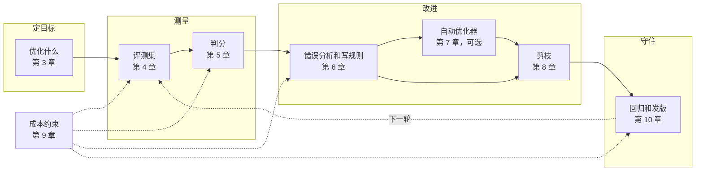

# 2. 全景图：一轮迭代由哪些部分组成

这一章不讲细节，只把后面各章放进同一张图里，说清楚它们之间的关系。

## 一轮迭代的五个环节

- **定目标**：变好是什么意思，skill 管什么、harness 管什么。
- **测量**：用什么题、怎么判对错。这一步定下来以后，后面的改动才有依据。
- **改进**：读失败的轨迹，归类，写成通用规则；可以人做，也可以部分交给自动优化器；改完要删。
- **守住**：确认新版本没有弄坏旧的，再发布。
- **成本约束**：不是一个单独的环节，而是贯穿始终的限制。跑一次越贵，每个环节越要精打细算。

## 三个贯穿全书的原则

1. **skill 的价值是差值**。带 skill 和不带 skill 比，差出来的那部分才是 skill 的作用。
2. **改动依据来自轨迹，不来自分数**。分数只告诉你有没有变好，轨迹才告诉你为什么。
3. **答案只给判官，不给 agent**。参考答案出现在 skill 里或 agent 能读到的地方，评测就失效了。

## 人和模型的分工

| 环节 | 适合自动化 | 适合人做 |
| --- | --- | --- |
| 跑评测、收集轨迹 | 是 | |
| 代码判分 | 是 | |
| 模型判分 | 是，但要用人工标注校准 | 校准 |
| 读轨迹、归类 | 模型可以帮忙找同类 | 前几十条自己读 |
| 写规则 | 模型可以提建议 | 判断是否通用、是否泄题 |
| 决定发不发版 | | 是 |

## 怎么读这本书

如果你只想马上开始，读第 4 章（评测集）和第 6 章（错误分析）就够做出 v2。手上的任务跑一次很贵，再加第 9 章。第 11 章的案例把全部做法串了一遍，第 12 章是要点汇总。
