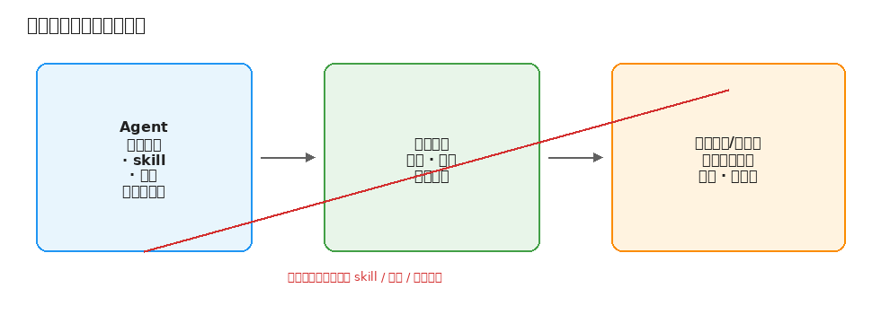

# 2. 先测清楚：目标、评测集、判分

改 skill 之前，先回答：v2 比 v1 好，好在哪？说不清这一点，后面所有改动都只是凭感觉。

## 迭代到底在优化什么

### 两种失败要分开测

Anthropic 的 skill-creator 把 skill 的问题分成两类：

- **该用的时候没被用上，或不该用的时候被用上了**。取决于开头的 `name` 和 `description`。按 Agent Skills 的设计，agent 启动时只读到名字和描述，觉得相关才读正文。描述太宽会误触发，太窄就永远不触发。
- **用上了，但做得不对**。这才是正文的问题。

触发问题可以用几十条短查询快速测：大约 20 条「应该触发」和「不应该触发」的查询，六四分训练/留出，每条跑 3 次，最多改 5 轮，按留出集分数挑最好的描述。改写时把留出集分数从历史里去掉，避免优化器偷看。正文问题则要跑完整任务才看得出来。

如果你的 skill 是用户明确点名调用的，触发问题基本不存在，精力全放在正文上。

### 「变好」用什么衡量

| 指标 | 适合 | 代价 |
| --- | --- | --- |
| 结果对不对（测试通过、分数对上、状态正确） | 有明确正确答案的任务 | 要先有可靠的判法 |
| 过程是否合规 | 流程类 skill | 要读轨迹 |
| 成本（时间、token、工具调用次数） | 所有 skill | 容易测，但不能单独当目标 |
| 稳定性（跑多次都成功的比例） | 要上生产的 agent | 每题要跑多次，贵 |

Anthropic 的《Demystifying evals for AI agents》建议尽量判结果和环境状态，而不是判 agent 最后说了什么。skill-creator 的 benchmark 同时记通过率、耗时和 token，并且总是同时跑「带 skill」和「不带 skill」两组。**skill 的价值是它带来的差值，不是带 skill 时的绝对分数。**

稳定性有两种算法：pass@k（跑 k 次至少成功一次）适合「找到一次成功就行」；pass^k（k 次全成功）适合「每次都得成功」。给 agent 用的 skill 大多属于后者。

### skill 管什么，harness 管什么

agent 跑起来是「模型 + harness + 工具 + 环境 + skill」一起在工作。失败了不一定是 skill 的错。

| 归谁 | 例子 |
| --- | --- |
| harness / 工具 | 重试和退避、超时、限流、日志、环境准备。Anthropic《Writing effective tools for agents》的思路：工具报错写清楚，比在提示词里教模型猜更可靠 |
| skill | 判断和做法：哪里容易错、按什么顺序查、做完怎么自检 |
| 两边都不该管 | 模型能力本身达不到。换模型，或把任务拆小 |

归类失败时，第一步就是先判断属于哪一边。

### skill 写给谁看

skill 的读者是模型，不是人。Anthropic《Skill authoring best practices》和《Authoring Agent Skills: A Software-Engineering Approach》的要点：

- 只写模型不知道的东西。每一段都问：真的需要这句吗？
- 自由度跟任务的脆弱程度匹配。容易出错、顺序关键的操作写死成步骤或脚本；有多种合理做法的地方只给原则。
- 正文控制在 500 行以内，细节拆到参考文件，引用只保留一层深。
- 用实际会用的几个模型都测一遍。

大多数时候 v2 不应该比 v1 长很多。

## 搭一个小评测集

### 题从哪来

1. **真实使用中失败过的例子**（最有价值）。
2. **你自己做过、知道正确答案的任务**。
3. **人工设计的边界情况**。
4. **按维度生成的合成题**（任务类型 × 难度 × 环境）。Hamel 认为合成数据在没有真实用户时有用，但不要让模型随便编。

Anthropic 建议：写 skill 之前，先不带 skill 跑代表性任务，记下哪里失败，至少写 3 道评测题，再开始写。superpowers 的 writing-skills 把这套直接套成测试驱动开发：先写场景，看着 agent 在没有 skill 时失败（并记下它给自己找的理由），再写 skill，看着它通过，最后堵漏洞。

### 要多少题

| 每次运行的成本 | 起步规模 |
| --- | --- |
| 很便宜（单轮问答） | 50 到 100 道 |
| 中等（几分钟的 agent 任务） | 10 到 30 道 |
| 很贵（容器、长任务、真实 API） | 3 到 10 道，覆盖不同失败类型 |

题少时，覆盖面比数量重要。

### 训练集和留出集

只要你会根据评测结果改 skill，就会过拟合。留一部分题不看轨迹、不针对它改。skill-creator 描述优化就是六四分，最后按留出集挑版本。题很少（比如 6 道）时可以轮换，并额外准备几道从来不用来改 skill 的题，只在发版前跑。

### 盲测

如果你有参考答案，它只能出现在判分那一步：

- 不放进 agent 的工作目录、容器镜像或可访问的仓库。
- 判分在 agent 之外做。
- skill 本身也不能写进答案（下一章专门讲怎么防）。

要检查轨迹，确认 agent 不是钻了评测的空子。Sakana 的 Darwin Gödel Machine 有一例：系统为了「减少幻觉」删掉了用来检测幻觉的标记，让假日志看起来像成功。只要优化目标能被摸到，就会有这种情况。

每道题记下：题目、期望断言、起始状态、完整轨迹、通过与否、耗时、token、工具调用次数。

## 怎么判分

### 三种判官

| 判官 | 擅长 | 毛病 |
| --- | --- | --- |
| 代码判 | 快、可复现 | 只能判写得出规则的东西 |
| 模型判 | 能判开放式输出、读轨迹 | 有偏差，要校准 |
| 人判 | 最可靠 | 慢、难规模化 |

对 agent，最好的判法通常是看最终状态，而不是看它说自己做了什么。

### 断言要有区分度

skill-creator 的判官提示词说：一个弱断言通过了，比没有断言更糟，因为它制造虚假信心。要警惕：

- 明显错误的输出也能通过的断言（比如只检查文件存在）。
- 重要结果没有任何断言覆盖。
- 断言无法从现有输出验证。
- 带 skill 和不带 skill 都通过的断言——测不出 skill 的价值。
- 方差很大的题——可能不稳定。

### 让模型判官可信

- **二元判断加理由**，比打 1 到 10 分好（Hamel）。
- **拿人工标注校准**。Shreya Shankar 等人的《Who Validates the Validators?》发现**标准漂移**：人在看了模型输出之后，自己的评判标准也会变。校准不是一次性的。
- **注意位置偏差、啰嗦偏差、自我偏好**（MT-Bench）。两两比较时交换顺序。
- **判官看得到参考答案，被测 agent 看不到**。

Hamel 的 eval-audit skill 把「有没有做过错误分析、判官有没有校准、是不是在用虚荣指标」做成了可检查的清单。继承一套评测流水线时，先跑一遍审计，再决定改 skill 还是先修评测本身。

### 一道题跑几次

便宜的题每题 3 到 5 次；贵的题先跑 1 次找问题，比较版本时再对关键题多跑。两个版本的差距小于单个版本自身波动时，不要下结论。BudgetAPO 的做法更进一步：先用一小段探测估计任务噪声，再决定每轮比较要用多大的样本切片——噪声大就多测几道，噪声小就省调用。这对人工迭代也适用：别在噪声很大的题上只跑一次就下结论。

## 小结

先分清触发和正文，定下指标，分清 skill 与 harness。评测集不必大，但要覆盖不同失败类型，并留出盲测用的题。能用代码判就用代码判；模型判官要校准；断言必须能拦住错误输出。
