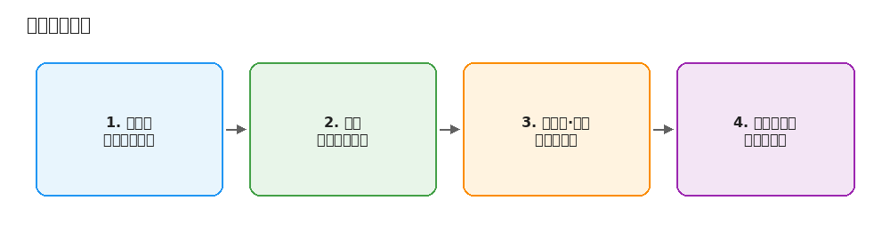
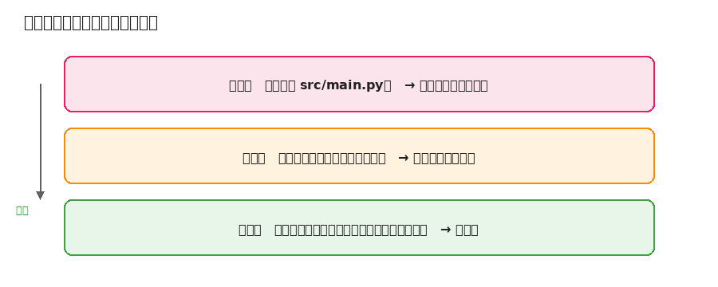

# 3. 改进：从失败轨迹到更短的下一版

这一章是迭代的核心：读失败、写成规则、再删掉没用的。多数人跳过读轨迹，直接盯着分数猜，结果是改了一处又坏一处。

## 错误分析

Hamel Husain 把错误分析称为 AI 开发里回报最高的活动，并反复强调：**先看数据**。在《The Revenge of the Data Scientist》里，他把读轨迹、记笔记、归类失败等同于经典的探索性数据分析——名字变了，活还是那些活。他和 Shreya 做的 evals-skills 插件里，入口 skill 多数时候会把你导向错误发现或评测审计，而不是先去搭仪表盘。

1. **读轨迹，写开放式笔记**。先自己读至少大约 30 条，再让模型帮你在剩下的里找同类。记**第一个错误**——上游错误会引发下游一串。
2. **把笔记归类，形成失败分类**。
3. **给每条轨迹打标签，数每类有多少**。
4. **按频率和严重程度决定先改哪类**。读到饱和就停：新轨迹不再带来新类别。

对 agent 轨迹，归类时先分边：skill 问题、harness/工具问题、环境问题，还是判官本身判错了。做一个顺手的轨迹查看器往往比上新工具更值钱。

## 把发现写成规则

找到失败之后，有三个层次，越往下越通用：

| 层次 | 例子 | 问题 |
| --- | --- | --- |
| 写答案 | 「这个仓库的入口在 `src/main.py`」 | 泄题，只对这道题有用 |
| 写情况 | 「如果仓库有多个入口，先找测试是怎么调用的」 | 稍好，仍可能太窄 |
| 写做法 | 「动手改之前，先找出评测实际执行的入口，并留下证据」 | 对没见过的题也适用 |

GEPA 的核心观点也是这个：让模型读轨迹、用自然语言反思出高层规则，比只看一个分数学得快。ACE 把这类规则积累成不断更新的操作手册，每次只做局部增、改、删。EvoSkill 更进一步：不只改一个提示词文件，而是从失败轨迹里发现或修改整个 skill 文件夹（说明、元数据、辅助脚本），用帕累托前沿保留在不同题上各有所长的变体，并在留出集上筛选；论文报告 OfficeQA 准确率从 60.6% 到 67.9%，SealQA 从 26.6% 到 38.7%，且 SealQA 上进化出的 skill 零样本迁移到 BrowseComp 还能再涨 5.3 个百分点——说明写到「做法」层的 skill 才有机会迁移。

**判断一条规则是不是泄题，问三句：**

1. 把这条规则交给从没见过这道题的人，他能不能猜出答案？能，就是泄题。
2. 这条规则在其他题上会不会用到？只用在这一道上，就太窄。
3. 删掉这道题之后，你还会写这条规则吗？不会，就是在过拟合。

另一个办法：让写规则的人（或模型）只看失败类别描述，不看原始轨迹。

## 每轮改多少、何时停

- 一轮只改一类问题，最多两三类。改太多，分数变了也不知道是哪一处。
- 按频率排序，先改最常见的，不是最有意思的。
- 记下：这一轮针对哪类失败、改了哪几行、预期哪几道题会变好。

可以停的信号：留出集已达标，剩下失败主要来自 skill 管不到的地方；连续两轮留出集没有提升；新轨迹不再出现新失败类别。OpenAI 自我进化示例用目标阈值（如 0.8）和最大重试次数（如 10）作停条件，超限就交回给人。

## 剪枝：防止越改越长

每次失败加一句，是最自然的迭代方式，也是 skill 变坏最常见的原因。

### 为什么长了会变差

- **指令多了会互相挤**。IFScale 测了 10 到 500 条指令，遵守率随数量下降。
- **位置有影响**。《Lost in the Middle》发现长上下文中间的信息最容易被忽略。
- **无关的格式也会影响分数**（Sclar 等）。小差距可能只是格式噪声。
- **每一句都占上下文**。Anthropic 的上下文工程文章把上下文当有限资源。

skill smells 论文把「该委托给参考文件的细节堆在正文」（Undelegated Details）等列为可检测的坏味道；另一篇大规模研究也发现描述过短、正文超 500 行等问题普遍。迭代时可以把「扫一遍 smells」当成剪枝清单的一部分。

### 怎么找出哪几句在起作用

| 方法 | 做法 | 成本 |
| --- | --- | --- |
| 整段消融 | 一次删一节，看分数掉不掉 | 节数 × 一次评测 |
| 不带 skill 的基线 | 看总差值 | 一次评测 |
| 看轨迹有没有用到 | 读轨迹，看有没有引用或遵守 | 只需读 |
| 断言对照 | 规则对应断言，不带 skill 也通过 → 可能没用 | 需要先有断言 |

评测贵时，先用后两种筛，再对少数几段做消融。

### 删的时候注意什么

- 标准是**留出集分数不掉**，不是「感觉没用」。
- **合并比删除安全**。
- **把细节移出正文**（渐进式披露）：正文留一句「遇到某情况读某文件」。
- **别删过头**。ACE 提醒的简短偏差：压太狠，领域细节没了。删完原来那几道题要再跑。

经验做法：每两三轮加内容之后，安排一轮只删不加。

## 小结

先读轨迹、归类、计数，再动手改。规则写做法不写答案。每隔几轮剪一次，用留出集分数当删的标准。
