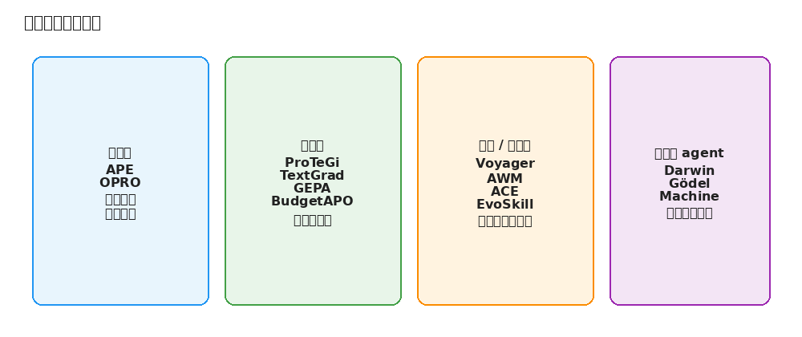
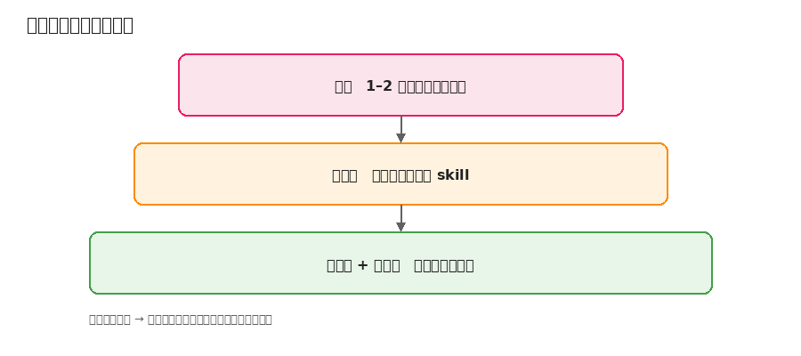

# 4. 加速与省钱：自动优化、高成本运行、发版

测量和改进的骨架有了之后，还要回答三个工程问题：能不能让模型自己改？跑一次很贵怎么办？怎么确认没改坏？

## 要不要交给自动优化器

| 类型 | 代表 | 核心做法 |
| --- | --- | --- |
| 搜索式 | APE、OPRO | 生成很多候选，按分数挑 |
| 反思式 | ProTeGi、GEPA、BudgetAPO | 读失败原因，用自然语言改写 |
| 积累 / 技能级 | Voyager、Agent Workflow Memory、ACE、EvoSkill | 把经验存成可复用的技能或工作流 |
| 改整个 agent | Darwin Gödel Machine | 连脚手架和工具代码一起改 |

要点：

- **GEPA**：读完整轨迹反思，保留帕累托前沿上的候选再合并。论文报告平均比 GRPO 高约 6 个百分点，运行次数最多少约 35 倍；也已进 DSPy。
- **BudgetAPO**：专为**紧预算**设计。先用约 16 次调用探测任务噪声，再决定评估切片大小；同一切片上做配对比较；一次同时改推理策略和输出格式。在 250 次调用的预算下，有实验显示它很少像 GEPA 那样把预算耗光后原样退回种子提示词（论文报告约 13% 对 86%）。**人工迭代可以直接借它的预算观**：先估噪声，再决定这轮值得跑几道题。
- **EvoSkill**：把 GEPA 的反思从「改一个提示词文件」抬到「发现和修改整个 skill 文件夹」，在留出集上筛选，并报告跨任务迁移。兼容 Claude Code、Codex、OpenHands、Harbor 等。适合已经有 benchmark、想让进化发生在 skill 层而不是权重层的团队。
- **AWS Bedrock AgentCore**：产品化的质量闭环——用真实轨迹生成系统提示词或工具描述的改进建议，配置打成不可变的 bundle 版本，再用 A/B 测统计显著性。输入必须指向一个**数值型评估器**：优化器会朝评估器给高分的方向推。这再次说明：判官选错，优化就会走偏。

Self-Refine、Reflexion 是这些方法的思路来源（单次运行内自评自改、把反思写入记忆）。两篇 2025 年综述（《A Survey of Self-Evolving Agents》《A Comprehensive Survey of Self-Evolving AI Agents》）可作地图。

### 什么时候用

| 情况 | 建议 |
| --- | --- |
| 评估便宜、分数可靠、题有几十道以上 | 可以用 GEPA、MIPROv2、OPRO、BudgetAPO |
| 评估很贵、题只有几道 | 不要让优化器自己空转。借「读轨迹提建议」，人来挑 |
| 判分靠未校准的模型判官 | 先校准。优化器会放大判官偏差 |
| skill 很长、结构复杂 | 拆开，一块一块改；或用 EvoSkill 这类按 skill 文件夹进化的工具 |
| 答案能被摸到 | 每轮读几条轨迹，防钻空子 |

对大多数 skill 作者，现实做法是**半自动**：评测自动化，建议由模型生成，取舍由人做。OpenAI 的提示词优化器、自我进化 cookbook，以及 AgentCore 的 recommendation + A/B，都是这个形状。

## 一次跑很贵时怎么迭代

- **分层跑**：先冒烟（1–2 道最容易出错的），再训练集，发版前才跑留出集和回归集。
- **轨迹存档，离线分析**：错误分析、写规则、校准判官都可以反复用同一批轨迹。
- **断点续跑**：Harbor 的 `harbor job resume` 可恢复任务；同样配置重跑会跳过已完成的试验。
- **能分段就分段**：只改了「读代码」阶段的规则，就只跑到写出方案那一步。
- **早停**：轨迹上已明显走错就停。
- **并发调到限流以下**：429 往往比「慢一点」更贵。

### 限流、重试归谁管

| 问题 | 放在哪 |
| --- | --- |
| 429、指数退避、重试、超时、进度保存 | harness 或工具脚本 |
| 遇到限流时要不要降并发、换跑法 | skill，写成一句判断 |
| 「分数异常时先检查是不是有题因报错被跳过」 | skill |

skill 里出现大段重试说明，通常意味着该写成脚本，让 skill 去调用（脚本代码不进上下文，只有输出进）。

题少时优先看**失败类型有没有消失**，而不是分数涨了几分；差距不大的结论标为「待确认」，等全量跑再核。

## 回归检查和发版

Anthropic 把评测分成两类：

- **能力评测**：测还做不好的事，分数应随迭代上升。
- **回归评测**：测已经做好的事，应接近满分。掉了就是改坏了。

一道能力题稳定通过后，移进回归集。发版前回归集必须全跑。

把 skill 当代码管：git 版本、改动说明写明针对哪类失败、评测结果跟版本号一起存、留着上一版以便回退。AgentCore 的 configuration bundle 是同一思想的云端版本：行为配置与代码解耦，可回滚。

模型升级后：重跑回归集和带/不带 skill 的对比。若不带 skill 已追上，考虑删减；若有题从通过变失败，按第 3 章读轨迹，不要直接加规则。

### 发版检查单

- 留出集分数不低于上一版。
- 回归集全部通过，或每个失败都有解释。
- 带 skill 与不带 skill 的差值为正。
- 正文没有无长很多；变长了能说出新增对应哪类失败。
- 新增规则里没有具体题目的答案。
- （可选）扫一遍 skill smells / 描述长度 / 正文行数。

## 小结

自动优化器在评估便宜时最有用；评估贵时借反思、人来拍板。高成本就分层跑、存轨迹、续跑，限流交给脚本。发版靠回归集和差值，不靠感觉。
