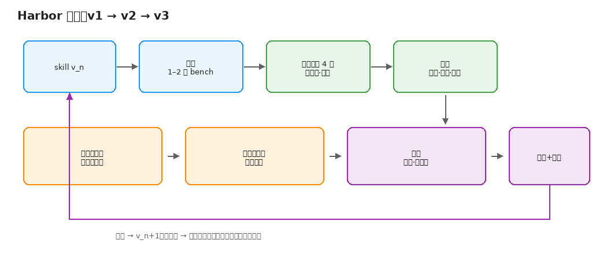

# 5. 案例：Harbor 接入 skill 的 v1 到 v3

用一个真实的端到端任务，把前面的做法串一遍。这里只是例子。

## 情况

- **skill v1**：教 agent 把一个 benchmark 接入 Harbor。要进容器读代码、写适配器、处理 API 429，跑完拿到分数。
- **参考答案**：作者手写过 6 个能跑通的接入，分数已知正确。代码不一定规范，但分数可信。
- **盲测**：agent 永远看不到这 6 份参考实现。对比在 agent 之外由人做。

## 第零步：把评测搭起来

| 要决定的 | 做法 |
| --- | --- |
| 题 | 6 个 benchmark，每个一道题 |
| 训练 / 留出 | 4 训练、2 留出；每轮或每两轮轮换。另找 1–2 个从没做过的，只在发版前跑 |
| 硬判分 | agent 分数与参考分数在容差内；题没有被静默跳过 |
| 软判分 | 是否符合 Harbor 适配器规范；有没有改动原 benchmark 的判分逻辑 |
| 过程记录 | 卡在哪一步、耗时、调用次数、429 次数 |
| 基线 | 同样 6 道题，不带 skill 跑一次（v0） |

参考实现只放在判分侧。

## 每一轮怎么跑

1. 冒烟：最容易出错的 1–2 个。
2. 跑训练集 4 个；断点续跑；轨迹全部存档。
3. 判分：分数、规范、卡点。
4. 读轨迹，按阶段归类（读代码 / 改代码 / 跑通 / 出分），再分边（skill vs harness/环境/模型）。
5. 只把 skill 问题写成**通用做法**。
6. 剪枝：合并、移进参考文件。
7. 跑留出集和回归集；不比上一版差才发 v_n+1。

## v1 → v2：先找最常见的失败

第一轮重点是错误分析，不急着改：

1. 6 道题各跑一次，加上不带 skill，共约 12 次运行。
2. 跟参考答案对比时，笔记只写「哪里不一样、为什么」，不写「正确答案是什么」。
3. 按第一个出错的阶段归类，计数。
4. 先改出现次数最多的一两类。

例如 agent 把原 benchmark 的判分改简单了、分数虚高：

- 写答案（不行）：「某 bench 的判分要用某函数」
- 写做法（可以）：「接入时不要修改原 benchmark 的判分逻辑。先在原仓库跑一次官方评测拿到参考输出，再确认 Harbor 里结果与之一致」

后一条让 agent 自己去找参考，而不是由 skill 提供参考。

若有 EvoSkill 或类似工具，也可以：把这 6 个 bench 配成 benchmark，让进化发生在 skill 文件夹层，但**仍然禁止**把参考实现放进进化 agent 可读的路径；留出集筛选照旧。

## v2 → v3：降成本，查回归

- 限流挪出 skill：429 重试写成脚本，skill 只留一句「调用模型时用某脚本」。
- 按阶段判分：只改「读代码」就只跑到方案那一步。
- 用 `harbor job resume` 代替整段重跑。
- 预算观（借 BudgetAPO）：若题间噪声大，冒烟多跑一次再决定是否全量。
- 回归：v1 已做对的题进回归集，v3 发版前必须仍做对。
- 剪一轮：对照轨迹看 v2 新加规则有没有被用到。

## 何时停

- 6 道题里分数对得上的数量不再增加，剩下失败主要来自环境或模型。
- 在额外的、从没用来改 skill 的 benchmark 上，表现和训练集差不多（差很多说明还在过拟合）。
- 新轨迹不再出现新失败类别。
