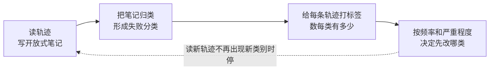

# 6. 从失败轨迹到下一版

这一步决定了 v2 改得对不对。多数人跳过它，直接看着分数猜原因改提示词，结果是改了一处又坏一处。

## 错误分析怎么做

Hamel Husain 把错误分析称为 AI 开发里回报最高的活动，做法借自质性研究：

几个要点：

- **先自己读，再让模型帮忙**。他建议先亲手标注至少 30 条轨迹，再让 agent 帮你在剩下的轨迹里找同类问题。
- **记第一个错误**。上游的错误会引发下游一串错误，只记最先出问题的那一步，归因会清楚很多。
- **读到饱和就停**。新读的轨迹不再带来新类别时，就可以停了。目标是找出最常见的失败，不是找全所有失败。
- **做一个顺手的查看工具**。他认为一个简单的数据查看器是最重要的投入，因为读轨迹的速度决定了你能读多少。

对 agent 轨迹，归类时先按上一章说的分边：这是 skill 的问题、harness 和工具的问题、环境的问题，还是判官本身判错了。Anthropic 的评测文章也强调要看轨迹，很多「失败」其实是题目有歧义或判官出错。

## 把发现写成规则：三个层次

找到一个失败之后，可以有三种改法，越往下越通用：

| 层次 | 例子 | 问题 |
| --- | --- | --- |
| 写答案 | 「这个仓库的入口在 `src/main.py`」 | 只对这道题有用，等于泄题 |
| 写情况 | 「如果仓库有多个入口，先找测试是怎么调用的」 | 好一些，但可能还是太窄 |
| 写做法 | 「动手改之前，先找出评测实际执行的入口，并在笔记里写下证据」 | 对没见过的题也适用 |

GEPA 论文的核心观点也是这个：让模型读轨迹、用自然语言反思出高层规则，比只看一个分数学得快得多。ACE 把这类规则积累成一份不断更新的「操作手册」，每次只做局部的增、改、删。

**判断一条规则是不是泄题，可以问三个问题**：

1. 把这条规则交给一个从没见过这道题的人，他能不能猜出这道题的答案？能，就是泄题。
2. 这条规则在其他题上会不会被用到？只在这一道题上用得到，就太窄了。
3. 删掉这道题之后，你还会写这条规则吗？不会，就是在对这道题过拟合。

另一个办法是让写规则的人（或模型）只看失败的类别描述，不看原始轨迹。skill-creator 在优化描述时，就把留出集的分数从改写模型能看到的历史里去掉了。

## 每轮改多少

- **一轮只改一类问题**，最多两三类。改太多，分数变了也不知道是哪一处起的作用。
- **按频率排序**。先改最常见的失败，不是最有意思的。
- **保留改动记录**：这一轮针对哪类失败、改了哪几行、预期哪几道题会变好。下一轮核对预期是否成立。

## 什么时候停

OpenAI 的自我进化 agent 示例里，循环在分数超过目标阈值（例子里是 0.8）或达到最大重试次数（例子里是 10）时停，后者会通知人来接手。手动迭代可以用类似的判断：

- 留出集已经达标，剩下的失败主要来自 skill 管不到的地方（模型能力、环境）。
- 连续两轮改动在留出集上都没有提升。
- 新读的轨迹不再出现新的失败类别。

## 小结

先读轨迹、归类、计数，再动手改；规则写做法而不是答案；一轮只改一两类问题，并记下预期。
