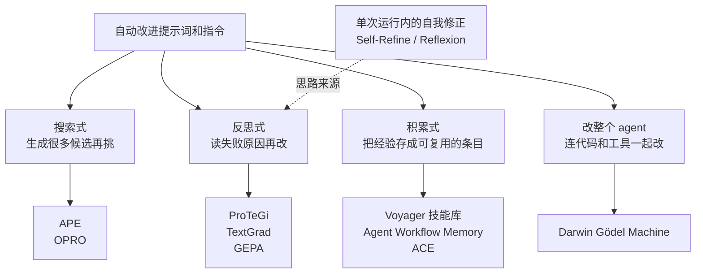

# 7. 要不要交给自动优化器

手动迭代慢，自然会想：能不能让模型自己改 skill？这方面的研究已经很多，但它们的前提条件差别很大，选错了反而更慢。

## 方法的大致谱系

- **搜索式**。APE 让模型根据输入输出例子生成一批候选指令，按分数挑最好的。OPRO 把历史上试过的提示词和它们的分数一起放进上下文，让模型提出新的，像一个用自然语言做的优化器。这两种都需要很多次评估，适合便宜、有明确分数的任务。
- **反思式**。ProTeGi 让模型针对失败的例子写一段「文字梯度」，说明提示词哪里不对，再据此修改，并用束搜索保留几个候选。TextGrad 把这个想法推广到整个系统，可以对多个组件传回文字反馈。GEPA 读完整轨迹（推理、工具调用、工具返回）来反思，并保留一组在不同题上各有所长的候选（帕累托前沿），再把它们的长处合并。GEPA 论文报告在六个任务上平均比 GRPO 强化学习高 6 个百分点，所用的运行次数最多少 35 倍，也比 DSPy 里此前领先的 MIPROv2 优化器高 10 个百分点以上。它已经集成进 DSPy。
- **积累式**。Voyager 在 Minecraft 里把成功的做法存成代码技能库，后面直接调用。Agent Workflow Memory 从过去的轨迹里提炼出可复用的工作流，在 Mind2Web 和 WebArena 上分别报告了 24.6% 和 51.1% 的相对成功率提升。ACE 把上下文当成一份不断演进的操作手册，由生成、反思、整理三个角色分工，每次只做局部的增、改、删。它指出了两个反方向的坑：改写式优化容易把内容压得太短，丢掉领域细节（简短偏差）；整份反复重写又会让积累的内容逐渐坍缩（上下文坍缩）。
- **改整个 agent**。Darwin Gödel Machine 让编码 agent 改自己的代码和工具，用基准分数筛选，保留一个变体档案。论文报告 SWE-bench 从 20% 提到 50%。同一篇论文也记录了它钻目标空子的例子（见第 4 章）。

Self-Refine 和 Reflexion 是这些方法的思路来源：前者在一次回答里让模型自评自改，后者把失败后的反思写进记忆，下次再试。它们改的是单次运行的输出，不改 skill 本身，但「用文字反馈代替分数」这个想法后来被反思式优化器继承了。

想系统了解这一块，有两篇 2025 年的综述可以看：《A Survey of Self-Evolving Agents》按进化什么、何时进化、怎么进化来组织；《A Comprehensive Survey of Self-Evolving AI Agents》从基础模型到终身学习系统梳理了一遍。

## 什么时候用，什么时候不用

| 情况 | 建议 |
| --- | --- |
| 每次评估很便宜，分数可靠，题有几十道以上 | 可以用 GEPA、MIPROv2、OPRO 这类优化器 |
| 每次评估很贵，题只有几道 | 不要让优化器自己跑循环。可以借它的做法：让模型读轨迹提建议，人来挑 |
| 判分靠模型判官，且没校准过 | 先校准判官。优化器会把判官的偏差放大 |
| skill 很长、结构复杂 | 优化器更适合改短的、单一职责的提示词；长 skill 拆开，一块一块改 |
| 任务答案能被摸到（测试文件、日志） | 小心钻空子，每一轮都要读几条轨迹 |

OpenAI 的提示词优化器和自我进化 agent 示例代表了一种折中：用评测、判官和人工标注作为输入，由模型生成新提示词，人决定是否采用。OpenAI 的另一个示例把轨迹、人工和模型反馈变成 Promptfoo 评测，再生成一份交给 Codex 实现的改动建议，默认是人审核后再合并。

对大多数 skill 作者，现实的做法是**半自动**：评测和判分自动化，改写建议由模型生成，取舍和合并由人做。

## 小结

自动优化器在评估便宜、分数可靠时最有用。评估很贵时，借用它们读轨迹、提建议的做法，由人来取舍。
