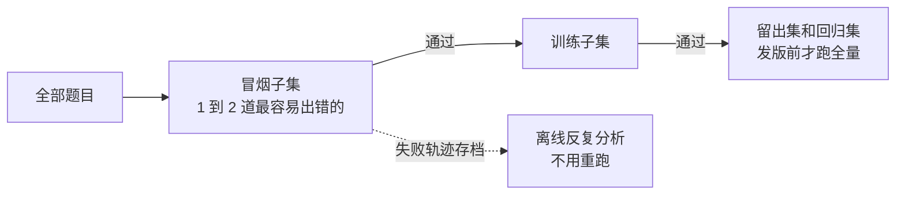

# 9. 一次跑很贵时怎么迭代

前面几章的做法默认可以多跑几次。如果每道题要起容器、跑几十分钟、调用会被限流的 API，每一轮都全量跑一遍很快就跑不起了。

## 省钱的几种办法

- **分层跑**。每次改动先跑一两道最容易出问题的题，过了再跑更多，发版前才跑全量。这和软件工程里每次提交跑冒烟测试、每晚跑完整测试是一个道理。
- **轨迹存档，离线分析**。一次运行的完整轨迹存下来，错误分析、写规则、校准判官都可以反复用，不用为了再看一眼而重跑。
- **断点续跑**。中途失败不要从头再来。Harbor 支持用 `harbor job resume` 恢复一个任务，同样配置重新运行时会跳过已经完成的试验。
- **能分段就分段**。端到端任务通常分几个阶段（读代码、改代码、跑通、出分）。如果某一轮只改了前面阶段的规则，可以只跑到那个阶段为止，用阶段性的检查判分。
- **早停**。从轨迹上看已经明显走错路的运行，及时停掉。
- **并发调到限流以下**。并发开太高会触发 429，反而更慢。Harbor 等框架有并发参数，从低往上调。

## 限流、重试和超时归谁管

第 3 章讲过，这些属于 harness 和工具，不属于 skill。具体来说：

| 问题 | 放在哪 | 原因 |
| --- | --- | --- |
| 429 限流、指数退避、重试 | harness 或工具脚本 | 确定性逻辑，模型自己处理既不稳又费 token |
| 超时和长任务的进度保存 | harness | 要在模型之外可靠地执行 |
| 遇到限流时要不要降低并发、换一种跑法 | skill，写成一句判断规则 | 这是判断，不是机械操作 |
| 「跑出来分数异常时先检查是不是有题因为报错被跳过」 | skill | 这是做法，换一个任务也用得上 |

如果 skill 里出现了大段处理重试的说明，通常意味着该写一个脚本，让 skill 去调用它。Anthropic 的 skill 最佳实践也建议，容易出错的确定性操作写成脚本放进 skill 目录，脚本的代码不进上下文，只有输出进。

## 跑得少的时候怎么下结论

- 优先看**失败类型有没有消失**，而不是分数涨了几分。题少的时候，分数受随机性影响太大。
- 一个改动如果针对的是某类失败，就去看那类失败出现的那几道题，确认它在轨迹里确实按新规则做了。
- 对差距不大的结论，标为「待确认」，等下一次全量跑时再核对。

## 小结

分层跑、存轨迹、断点续跑、控制并发；限流和重试写成脚本；题少时看失败类型是否消失，而不是分数涨了几分。
