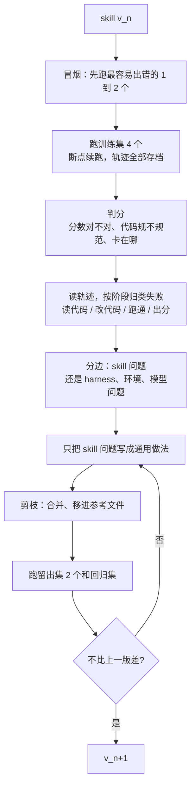

# 11. 案例：Harbor 接入 skill 的 v1 到 v3

最后用一个真实的端到端任务，把前面的做法串一遍。这里只是一个例子，同样的思路可以套到其他 skill 上。

## 情况

- **skill v1**：教 agent 把一个 benchmark 的代码接入 Harbor 评测框架。agent 要进容器读代码、写适配器、处理 API 的 429 限流，跑完拿到分数。
- **参考答案**：作者手写过 6 个能跑通的 Harbor 接入，分数已知是对的。代码不一定规范，但分数可信。
- **盲测**：agent 永远看不到这 6 份参考实现。agent 只拿到 skill 和 benchmark，自己做完、跑出分数；对比在 agent 之外由人来做。

## 第零步：把评测搭起来

| 要决定的 | 这个案例里的做法 |
| --- | --- |
| 题 | 6 个 benchmark，每个是一道题 |
| 训练集和留出集 | 4 个训练，2 个留出；每一轮或每两轮轮换一次。再从没做过的 benchmark 里另找一两个，只在发版前跑 |
| 硬判分（代码判） | agent 跑出的分数和参考分数差距在容差内；所有题都被执行，没有被静默跳过 |
| 软判分（模型判加人判） | 代码是否符合 Harbor 的适配器规范；有没有改动 benchmark 原本的判分逻辑 |
| 过程记录 | 卡在哪一步、花了多久、调用了多少次、遇到几次 429 |
| 基线 | 同样的 6 道题，不带 skill 跑一次，得到 v0 |

参考实现只放在判分机器上，不放进 agent 的容器、工作目录或可访问的仓库。判官（模型或人）比对时可以看参考实现，agent 不能。

## 每一轮的循环

## v1 到 v2：先找最常见的失败

第一轮重点是错误分析，不急着改：

1. 6 道题各跑一次，加上不带 skill 的一次，共 12 次运行。轨迹全部存下来。
2. 拿 agent 的结果跟参考答案对比，但写笔记时只写「哪里做得不一样、为什么不一样」，不写「正确答案是什么」。
3. 按第一个出错的阶段归类，数每一类有多少。
4. 先改出现次数最多的一两类。

把发现变成规则时，按第 6 章的三个层次往上推。比如对比发现 agent 把 benchmark 原来的判分逻辑改简单了，分数虚高：

- 写答案（不行）：「某 benchmark 的判分要用某函数」
- 写做法（可以）：「接入时不要修改原 benchmark 的判分逻辑。先在原仓库里跑一次官方评测拿到参考输出，再确认 Harbor 里跑出的结果与之一致」

后一条对没见过的 benchmark 也成立，而且它让 agent 自己去找参考，而不是由 skill 提供参考。

## v2 到 v3：降成本，查回归

- **限流挪出 skill**：如果 v1 里有大段处理 429 的说明，把重试和退避写成脚本，skill 里只留一句「调用模型时用某脚本」。
- **按阶段判分**：如果这一轮的改动只涉及「读代码」阶段，那么只跑到 agent 写出适配器方案那一步，判断方案对不对，不必等完整跑分。
- **用续跑代替重跑**：Harbor 的 `harbor job resume` 可以接着上次中断的地方跑。
- **回归检查**：v1 已经做对的题放进回归集，v3 发版前必须仍然做对。
- **剪一轮**：对照轨迹看 v2 新加的规则有没有被用到，没用到的考虑删掉或移进参考文件。

## 怎么判断可以停

- 6 道题里，分数对得上的数量不再增加，剩下的失败主要来自环境或模型能力。
- 在另外找的、从没用来改 skill 的 benchmark 上，v3 的表现和训练集上差不多。差很多，说明还在对这 6 个过拟合。
- 新读的轨迹不再出现新的失败类别。
